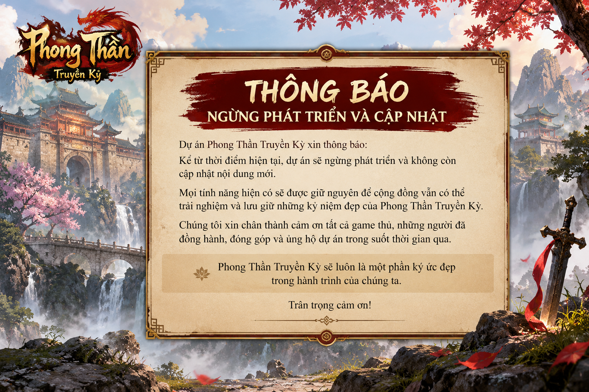

> **THÔNG BÁO — DỰ ÁN NGỪNG PHÁT TRIỂN VÀ CẬP NHẬT TỪ NGÀY 16/10/2026**
>
> **Phong Thần Truyền Kỳ** chính thức dừng phát triển, sửa lỗi và cập nhật nội dung mới. Đây là quyết định dừng hoạt động phát triển dự án, **không phải thông báo rằng game đã hoàn thiện hoặc vận hành ổn định**.
>
> Repository cùng mã nguồn, tài nguyên hiện có, lịch sử thay đổi và tài liệu **được giữ lại để tra cứu, học tập và lưu giữ dấu ấn của dự án**. Không cam kết duy trì máy chủ, hỗ trợ kỹ thuật, xử lý issue/PR hay phát hành phiên bản tiếp theo. Các bản build và hướng dẫn bên dưới được cung cấp **nguyên trạng, chỉ để tham khảo**.
>
> Chân thành cảm ơn mọi người đã quan tâm, đóng góp và đồng hành cùng dự án trong thời gian qua.

---

# Phong Thần Truyền Kỳ

**Dự án phục dựng game Phong Thần (PTTK)** — lưu trữ mã nguồn C/C++, dữ liệu Client/Server, công cụ khôi phục tài nguyên và quy trình build/kiểm thử Windows x86.

Tên hiển thị trong client/INI cũ: `Phong Than Truyen Ky` ([quy ước branding](docs/BRANDING.md)).

> **Trạng thái kỹ thuật được ghi nhận trước khi dừng:** Mã nguồn từng biên dịch thành công, nhưng **chưa có xác nhận hoàn tất đăng nhập, lưu nhân vật và gameplay trên Windows VM**. Repository **không phải bản game sẵn sàng phát hành công khai**.

## Trạng thái kỹ thuật tại thời điểm dừng

| Hạng mục | Kết quả | Bằng chứng / bước tiếp theo |
| --- | --- | --- |
| Build Windows x86 | **PASS — 22/22 EXE/DLL** | [Build tổng hợp](https://github.com/ePlus-Game/phong-than-truyen-ky/actions/runs/38564658067) |
| Kiểm tra EXP cấp 131–200 | **Đã sửa code, test PASS** | [PR #70](https://github.com/ePlus-Game/phong-than-truyen-ky/pull/70) · [Kiểm thử EXP](https://github.com/ePlus-Game/phong-than-truyen-ky/actions/runs/38564658247) |
| Kiểm tra tĩnh runtime | **Có công cụ và CI** | [PR #73](https://github.com/ePlus-Game/phong-than-truyen-ky/pull/73) |
| Khởi động server, login và chơi thử | **Chưa nghiệm thu** | [Issue #71](https://github.com/ePlus-Game/phong-than-truyen-ky/issues/71) |

Xem [**Master Roadmap**](docs/MASTER_ROADMAP.md) để tra cứu kế hoạch và điều kiện nghiệm thu trước khi dự án dừng. Roadmap **không còn là cam kết triển khai**. **Build PASS không đồng nghĩa game đã chạy ổn định.**

## Tra cứu và chạy thử bản lưu trữ

### 1. Lấy source

Clone repository bằng Git (khuyến nghị với kho dữ liệu lớn):

```bash
git clone https://github.com/ePlus-Game/phong-than-truyen-ky.git
cd phong-than-truyen-ky
```

Bạn cũng có thể chọn **Code → Download ZIP** trên GitHub. Tuy nhiên repository chứa nhiều dữ liệu game dung lượng lớn nên ZIP có thể tải lâu hoặc gặp giới hạn. Xem [Repository Hygiene](docs/REPOSITORY_HYGIENE.md) trước khi dọn dẹp hoặc tải lại dữ liệu.

### 2. Khôi phục các PAK đã chia nhỏ

Một số tài nguyên lớn được lưu thành **16 PAK chia 102 phần**. Sau khi tải **đầy đủ** các phần, chạy tại thư mục gốc:

```powershell
powershell.exe -NoProfile -File .\tools\Restore-SplitPaks.ps1 -RepoRoot .
```

Công cụ dùng **Windows PowerShell 5.1 có sẵn**, không cần cài Python. Lệnh `PhongThan-ChayTatCa.cmd game` cũng tự gọi công cụ này nếu chưa có runtime đang chạy. Công cụ dùng manifest để ghép PAK thiếu và xác minh SHA-256; các PAK đã tồn tại được kiểm tra kích thước (dùng `-VerifyExisting` để kiểm tra SHA-256 đầy đủ). Cần có đủ `*.pak.parts/part-*.bin` và dung lượng đĩa trống. Không sửa hoặc đổi mã hóa tài nguyên gốc.

### 3. Kiểm tra công cụ và bản build

```powershell
python -m unittest discover -s tests -v
```

Nếu đã có **bản sao** runtime Windows với thư mục `Client/` và `Server/`, có thể chạy kiểm tra tĩnh:

```powershell
python tools/runtime_preflight.py --root "D:\PT-UAT\PhongThanRuntime-Staging" --mode runtime --manifest "PhongThanSource\Deploy\RUNTIME_CONTENT_MANIFEST.json"
```

Kết quả `READY_FOR_RUNTIME_TEST` **chỉ cho biết các tệp/cấu hình đạt kiểm tra ban đầu**, không phải kết quả chơi thử. Xem [hướng dẫn nghiệm thu Windows](docs/RUNTIME_GAMEPLAY_ACCEPTANCE.md).

### 4. Cài đặt và khởi chạy thử

Đây là mã nguồn **lưu trữ**, chưa được xác nhận là game có thể chơi ổn định. Trên bản sao thử nghiệm Windows, `PhongThan-ChayTatCa.cmd game` sẽ khôi phục PAK còn thiếu, chuẩn bị SQL LocalDB, kiểm tra và khởi động server, sau đó mở admin/client. Trước khi chạy các file `.cmd` hoặc `.exe`, hãy đọc [hướng dẫn launcher](docs/LAUNCHER_BEHAVIOR.md), [vai trò các EXE](docs/EXECUTABLE_GUIDE.md) và [bộ cài phụ thuộc](install/README.md). Chỉ thử trên **Windows VM cách ly và bản sao dữ liệu**, không trỏ vào database/tài khoản thật.

### Web Admin: mở khóa phát vật phẩm đúng PAK

Web Admin vẫn tạo tài khoản khi thiếu `PakEntryExtract.exe`, nhưng việc phát vật phẩm bị khóa cho đến khi **trích xuất thành công toàn bộ 15 bảng từ PAK**. Có thể sử dụng [quy trình build PAK extractor Windows x86 trên GitHub Actions](docs/ADMIN_PAK_EXTRACTOR.md) và giải nén artifact riêng vào `AdminWeb/bin/` (không thay thế DLL trong runtime game). Công cụ cần xác minh bằng PAK thật trên máy thử nghiệm.

## Cấu trúc repository

```text
.
├── PhongThanSource/          # Source C/C++ và công cụ build
├── PhongThanRuntime-Staging/ # Client, Server và dữ liệu game
├── PhongThanRuntime-State/   # Dữ liệu trạng thái kế thừa từ bản lưu gốc
├── AdminWeb/                 # Công cụ quản trị
├── install/                  # Bộ cài phụ thuộc
├── archive/                  # Manifest/hash và dấu vết tài liệu lịch sử
├── tools/                    # Khôi phục PAK, kiểm tra source/runtime
├── tests/                    # Unit test và kiểm tra công cụ
├── docs/                     # Tài liệu dự án và bản gốc
└── .github/workflows/        # GitHub Actions
```

Nội dung `PT/` từ bản archive cũ đã được đưa lên thư mục gốc. Chi tiết ánh xạ đường dẫn, dữ liệu được giữ nguyên và cách khôi phục nằm tại [Repository Layout](docs/REPOSITORY_LAYOUT.md).

## Tài liệu

| Chủ đề | Tài liệu |
| --- | --- |
| **Người chơi** | [Cẩm nang tổng hợp](docs/PLAYER_HANDBOOK.md) · [Tân thủ](docs/NEW_PLAYER_GUIDE.md) · [Nhiệm vụ tân thủ](docs/BEGINNER_QUESTS.md) |
| **Gameplay & dữ liệu** | [Đối chiếu gameplay với source](docs/GAMEPLAY_SOURCE_AUDIT.md) · [Hệ thống nhiệm vụ](docs/QUEST_SYSTEM_STATUS.md) · [Phần thưởng và Linh Thú](docs/REWARDS_AND_PETS.md) |
| **Build & chạy thử** | [Windows x86 build](docs/M1_WINDOWS_BUILD.md) · [Nghiệm thu runtime](docs/RUNTIME_GAMEPLAY_ACCEPTANCE.md) · [Ma trận kiểm thử](docs/TEST_MATRIX.md) |
| **Phát triển & quản lý** | [Roadmap](docs/MASTER_ROADMAP.md) · [Refactoring](docs/REFACTORING.md) · [Repository Hygiene](docs/REPOSITORY_HYGIENE.md) |
| **Vận hành & nhận diện** | [Launcher](docs/LAUNCHER_BEHAVIOR.md) · [Danh mục EXE](docs/EXECUTABLE_GUIDE.md) · [Branding](docs/BRANDING.md) · [Cài đặt phụ thuộc](install/README.md) |

**Lưu ý:** Cẩm nang có đối chiếu tài liệu Phong Thần VNG và code phục dựng. Các thông tin chưa kiểm thử trực tiếp được ghi rõ, không nên xem là gameplay đã vận hành.

## Trạng thái tiếp nhận đóng góp & an toàn dữ liệu

- Dự án **không còn tiếp nhận và xử lý thường xuyên các thay đổi tính năng, lỗi hoặc yêu cầu hỗ trợ**. Bạn có thể fork để tự nghiên cứu; đừng hiểu tài liệu cũ là kế hoạch tiếp tục phát triển.
- Không commit tài khoản, mật khẩu, dữ liệu nhân vật, database cá nhân, binary phát hành ngoài phạm vi cho phép hoặc log nhạy cảm.
- Giữ nguyên dữ liệu/PAK gốc; với C++ và Lua mã hóa legacy, tránh chuyển mã hàng loạt. Build trên **bản sao ngoài checkout**.
- [Roadmap](docs/MASTER_ROADMAP.md) và [test matrix](docs/TEST_MATRIX.md) được giữ như **tư liệu lịch sử**, không còn được theo dõi như đầu việc đang triển khai.

---

<sub>**Phong Thần Truyền Kỳ** · Source restoration project · [Theo dõi các đầu việc](https://github.com/ePlus-Game/phong-than-truyen-ky/issues) · [Lịch sử thay đổi](CHANGELOG.md)</sub>
